# Imágenes extraídas para Integra

18 imágenes seleccionadas: 15 vistas de equipos y 3 recortes de proyectos. Las versiones WebP conservan proporción y no se amplían por encima de la resolución extraída. Las imágenes pequeñas del Excel sirven para tarjetas; no tienen resolución suficiente para un hero de pantalla completa.

Las fotos del catálogo y fabricante son ilustrativas. La fotografía de Bobcat muestra 250 EFI, distinta de la celda BOBCAT225. No usarla como foto confirmada de ese modelo. No se han insertado imágenes en la página.

## Selección para la web

| Imagen | Fuente | Resolución WebP | Estado |
| --- | --- | --- | --- |
| [Met: FORZA Ranger N1530P60](seleccion-web/met-01-forza-ranger.webp) | S2 p. 2 | 1600 ×751 px | Imagen de fabricante |
| [Met: FORZA Press FXP42T250](seleccion-web/met-02-forza-press.webp) | S3 p. 2 | 844 ×551 px | Imagen de fabricante |
| [Met: roladora CDP 800, vista vertical](seleccion-web/met-03-roladora-vertical.webp) | S5 p. 6 | 591 ×859 px | Fotografía de documento del proveedor |
| [Met: roladora CDP 800, vista horizontal](seleccion-web/met-03-roladora-horizontal.webp) | S5 p. 6 | 1024 ×576 px | Fotografía de documento del proveedor |
| [Rent: plataforma de tijera Zoomlion](seleccion-web/rent-01-zoomlion-tijera.webp) | S6 Hoja1, imagen 04, G3 | 141 ×256 px | Ilustrativa; especificaciones ausentes |
| [Rent: plataforma articulada Genie](seleccion-web/rent-02-genie-articulada.webp) | S6 Hoja1, imagen 03, G4 | 205 ×261 px | Ilustrativa |
| [Rent: grúa Broderson](seleccion-web/rent-03-broderson-grua.webp) | S6 Hoja1, imagen 05, I5 | 229 ×318 px | Ilustrativa; capacidad por confirmar |
| [Rent: torre de iluminación](seleccion-web/rent-04-torre-iluminacion.webp) | S6 Hoja1, imagen 16, H6 | 360 ×435 px | Ilustrativa |
| [Rent: montacargas UniCarrier](seleccion-web/rent-05-montacargas.webp) | S6 Hoja1, imagen 08, G7 | 515 ×346 px | Imagen ilustrativa; no confirma configuración de unidad |
| [Rent: soldadora Miller Deltaweld](seleccion-web/rent-06-miller-deltaweld.webp) | S6 Hoja1, imagen 10, G8 | 347 ×427 px | Ilustrativa |
| [Rent: rompedora DeWalt](seleccion-web/rent-07-dewalt-rompedora.webp) | S6 Hoja1, imagen 12, G9 | 652 ×320 px | Ilustrativa |
| [Rent: revolvedora de un saco](seleccion-web/rent-08-revolvedora.webp) | S6 Hoja1, imagen 13, G10 | 573 ×534 px | Ilustrativa |
| [Rent: soldadora Infra](seleccion-web/rent-09-infra-soldadora.webp) | S6 Hoja1, imagen 17, H11 | 456 ×451 px | Modelo pendiente |
| [Rent: Miller Bobcat, foto 250 EFI](seleccion-web/rent-10-bobcat-modelo-por-confirmar.webp) | S6 Hoja1, imagen 19, I12 | 355 ×386 px | NO asociar a Bobcat225 sin confirmar |
| [Rent: ESAB Ruffian](seleccion-web/rent-11-esab-ruffian.webp) | S6 Hoja1, imagen 20, O13 | 458 ×384 px | Ilustrativa |
| [Racks de proyecto](seleccion-web/integra-racks.webp) | S1 p. 16 | 1425 ×935 px | Recorte de foto de presentación; proyecto específico |
| [Dolly de proyecto](seleccion-web/integra-dolly.webp) | S1 p. 16 | 1340 ×935 px | Recorte de foto de presentación; proyecto específico |
| [Pailería y bastidores de proyecto](seleccion-web/integra-paileria.webp) | S1 p. 18 | 1600 ×972 px | Recorte de foto de presentación; proyecto específico |

## Galería

### Met: FORZA Ranger N1530P60

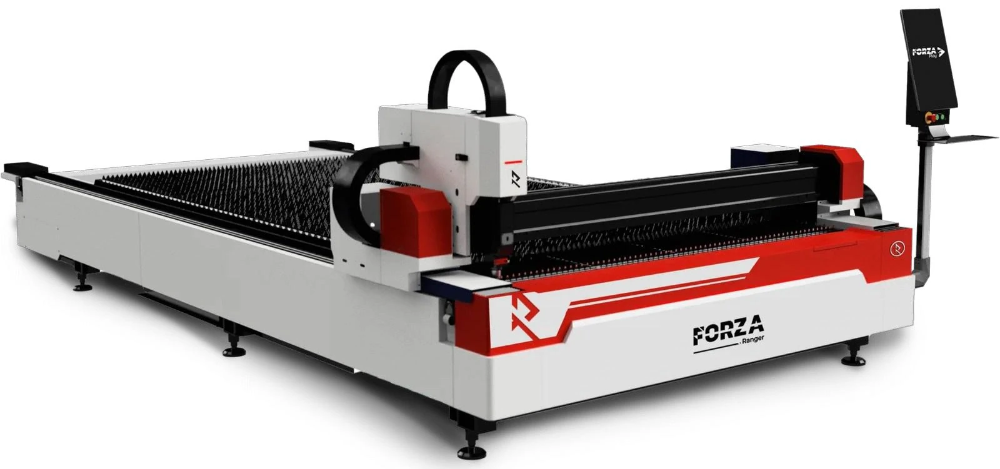

S2 p. 2. Imagen de fabricante.

### Met: FORZA Press FXP42T250

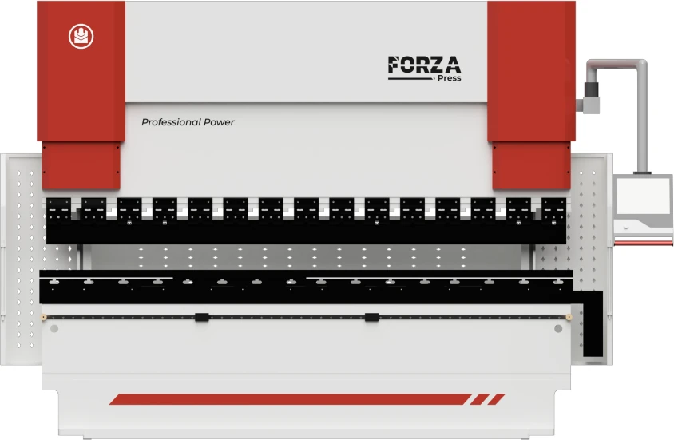

S3 p. 2. Imagen de fabricante.

### Met: roladora CDP 800, vista vertical

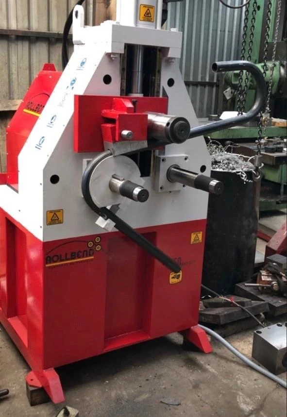

S5 p. 6. Fotografía de documento del proveedor.

### Met: roladora CDP 800, vista horizontal

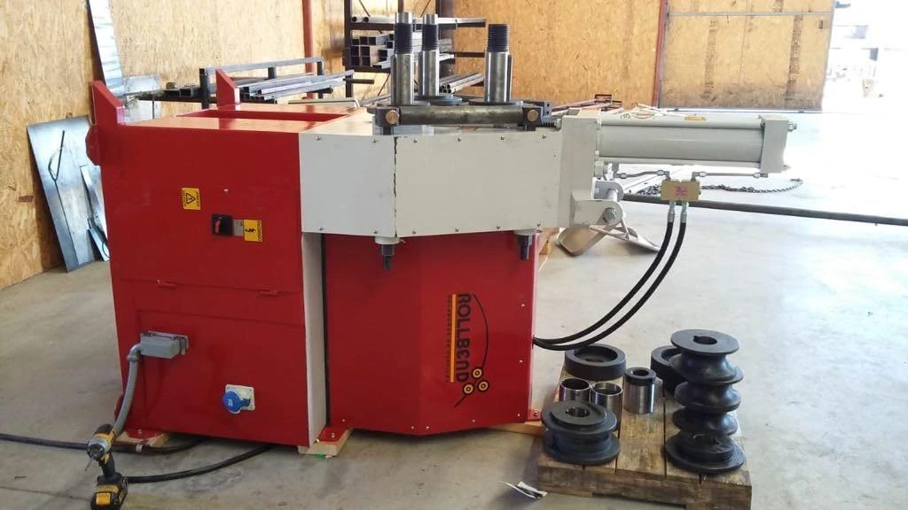

S5 p. 6. Fotografía de documento del proveedor.

### Rent: plataforma de tijera Zoomlion

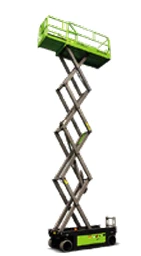

S6 Hoja1, imagen 04, G3. Ilustrativa; especificaciones ausentes.

### Rent: plataforma articulada Genie

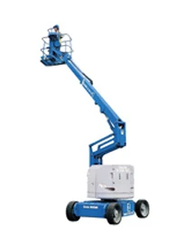

S6 Hoja1, imagen 03, G4. Ilustrativa.

### Rent: grúa Broderson

S6 Hoja1, imagen 05, I5. Ilustrativa; capacidad por confirmar.

### Rent: torre de iluminación

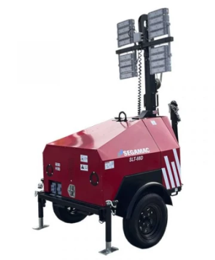

S6 Hoja1, imagen 16, H6. Ilustrativa.

### Rent: montacargas UniCarrier

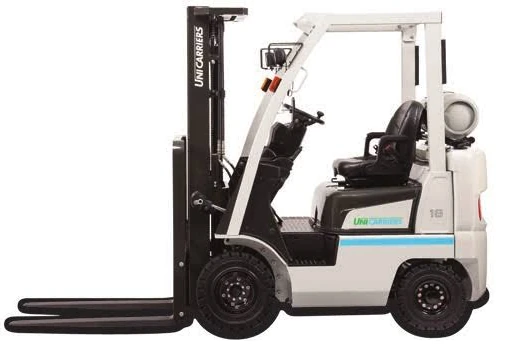

S6 Hoja1, imagen 08, G7. Imagen ilustrativa; no confirma configuración de unidad.

### Rent: soldadora Miller Deltaweld

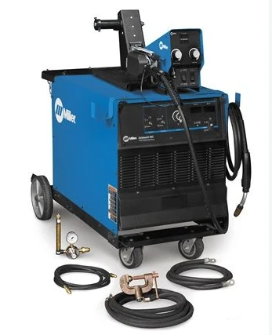

S6 Hoja1, imagen 10, G8. Ilustrativa.

### Rent: rompedora DeWalt

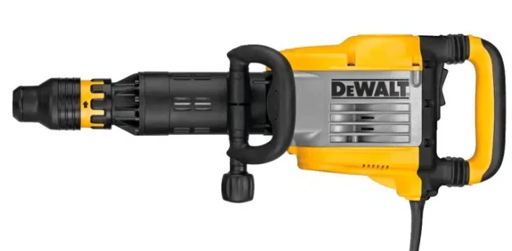

S6 Hoja1, imagen 12, G9. Ilustrativa.

### Rent: revolvedora de un saco

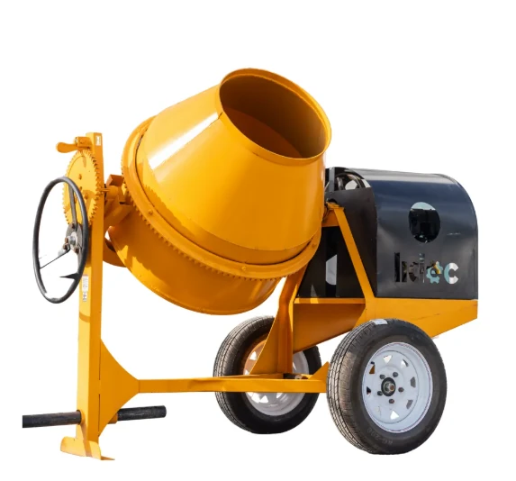

S6 Hoja1, imagen 13, G10. Ilustrativa.

### Rent: soldadora Infra

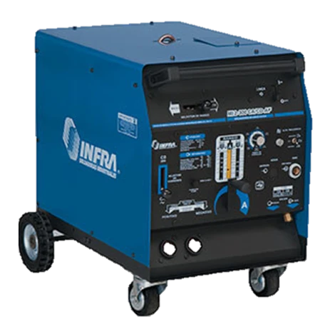

S6 Hoja1, imagen 17, H11. Modelo pendiente.

### Rent: Miller Bobcat, foto 250 EFI

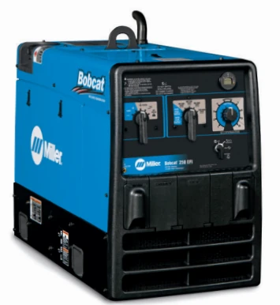

S6 Hoja1, imagen 19, I12. NO asociar a Bobcat225 sin confirmar.

### Rent: ESAB Ruffian

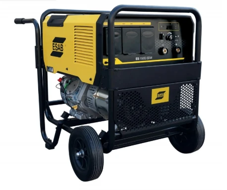

S6 Hoja1, imagen 20, O13. Ilustrativa.

### Racks de proyecto

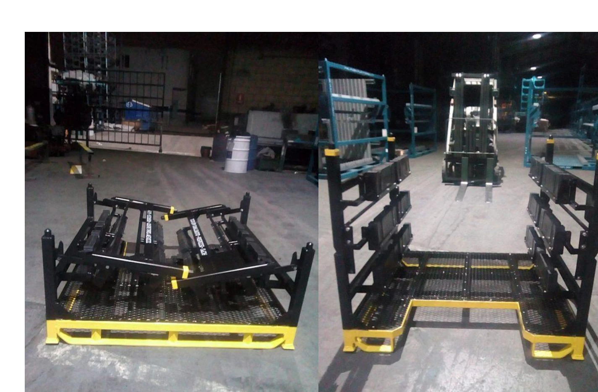

S1 p. 16. Recorte de foto de presentación; proyecto específico.

### Dolly de proyecto

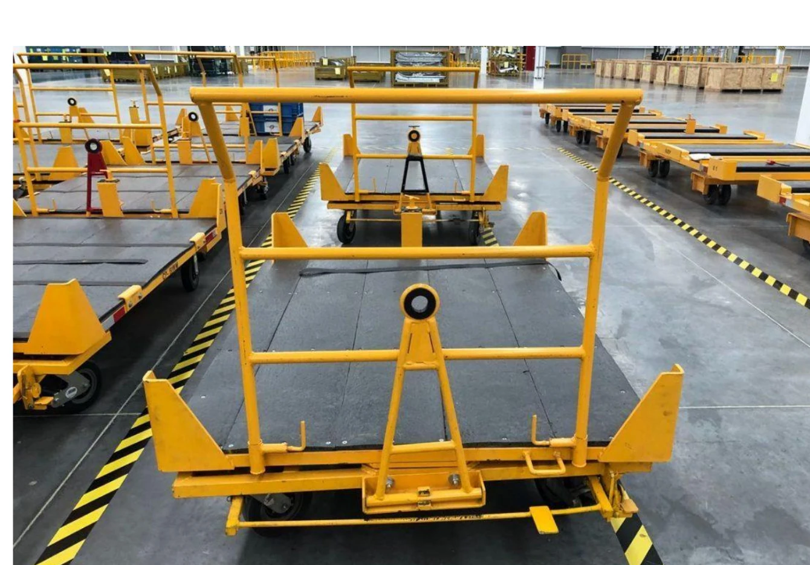

S1 p. 16. Recorte de foto de presentación; proyecto específico.

### Pailería y bastidores de proyecto

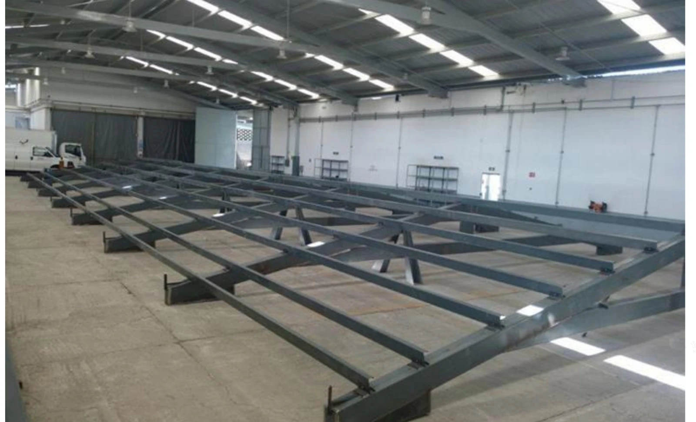

S1 p. 18. Recorte de foto de presentación; proyecto específico.

## Imágenes originales y evidencia

Se conservaron las 156 imágenes extraídas de tamaño mínimo 100 ×100 px. Incluyen fotografías, diapositivas completas, fondos, dibujos y tablas, no 156 fotografías de equipos distintas. Los fondos repetidos conservan referencia por página. Las tablas pequeñas o vectoriales no extraídas como imagen independiente se preservan en el PDF original y, para los esquemas clave, en `referencias/`. Los originales no son una selección para publicar.

| Archivo | Fuente / ubicación | Tamaño |
| --- | --- | --- |
| [s1-p01-img01.png](imagenes/s1-p01-img01.png) | S1 p. 1 | 3000 ×2250 px |
| [s1-p02-img01.png](imagenes/s1-p02-img01.png) | S1 p. 2 | 3000 ×2250 px |
| [s1-p03-img01.png](imagenes/s1-p03-img01.png) | S1 p. 3 | 3000 ×2250 px |
| [s1-p04-img01.png](imagenes/s1-p04-img01.png) | S1 p. 4 | 3000 ×2250 px |
| [s1-p05-img01.png](imagenes/s1-p05-img01.png) | S1 p. 5 | 3000 ×2250 px |
| [s1-p06-img01.png](imagenes/s1-p06-img01.png) | S1 p. 6 | 3000 ×2250 px |
| [s1-p07-img01.png](imagenes/s1-p07-img01.png) | S1 p. 7 | 3000 ×2250 px |
| [s1-p08-img01.png](imagenes/s1-p08-img01.png) | S1 p. 8 | 3000 ×2250 px |
| [s1-p09-img01.png](imagenes/s1-p09-img01.png) | S1 p. 9 | 3000 ×2250 px |
| [s1-p10-img01.png](imagenes/s1-p10-img01.png) | S1 p. 10 | 3000 ×2250 px |
| [s1-p11-img01.png](imagenes/s1-p11-img01.png) | S1 p. 11 | 3000 ×2250 px |
| [s1-p12-img01.png](imagenes/s1-p12-img01.png) | S1 p. 12 | 3000 ×2250 px |
| [s1-p13-img01.png](imagenes/s1-p13-img01.png) | S1 p. 13 | 3000 ×2250 px |
| [s1-p14-img01.png](imagenes/s1-p14-img01.png) | S1 p. 14 | 3000 ×2250 px |
| [s1-p15-img01.png](imagenes/s1-p15-img01.png) | S1 p. 15 | 3000 ×2250 px |
| [s1-p16-img01.png](imagenes/s1-p16-img01.png) | S1 p. 16 | 3000 ×2250 px |
| [s1-p17-img01.png](imagenes/s1-p17-img01.png) | S1 p. 17 | 3000 ×2250 px |
| [s1-p18-img01.png](imagenes/s1-p18-img01.png) | S1 p. 18 | 3000 ×2250 px |
| [s1-p19-img01.png](imagenes/s1-p19-img01.png) | S1 p. 19 | 3000 ×2250 px |
| [s1-p20-img01.png](imagenes/s1-p20-img01.png) | S1 p. 20 | 3000 ×2250 px |
| [s1-p21-img01.png](imagenes/s1-p21-img01.png) | S1 p. 21 | 3000 ×2250 px |
| [s1-p22-img01.png](imagenes/s1-p22-img01.png) | S1 p. 22 | 3000 ×2250 px |
| [s2-p01-img01.jpeg](imagenes/s2-p01-img01.jpeg) | S2 p. 1 | 1692 ×2394 px |
| [s2-p01-img02.png](imagenes/s2-p01-img02.png) | S2 p. 1 | 684 ×236 px |
| [s2-p02-img01.png](imagenes/s2-p02-img01.png) | S2 p. 2 | 547 ×831 px |
| [s2-p02-img03.jpeg](imagenes/s2-p02-img03.jpeg) | S2 p. 2 | 1600 ×751 px |
| [s2-p02-img04.png](imagenes/s2-p02-img04.png) | S2 p. 2 | 364 ×125 px |
| [s2-p03-img01.png](imagenes/s2-p03-img01.png) | S2 p. 3 | 547 ×831 px |
| [s2-p03-img03.jpeg](imagenes/s2-p03-img03.jpeg) | S2 p. 3 | 841 ×472 px |
| [s2-p04-img01.png](imagenes/s2-p04-img01.png) | S2 p. 4 | 547 ×831 px |
| [s2-p04-img03.png](imagenes/s2-p04-img03.png) | S2 p. 4 | 221 ×194 px |
| [s2-p04-img04.png](imagenes/s2-p04-img04.png) | S2 p. 4 | 739 ×641 px |
| [s2-p04-img05.png](imagenes/s2-p04-img05.png) | S2 p. 4 | 221 ×194 px |
| [s2-p04-img06.png](imagenes/s2-p04-img06.png) | S2 p. 4 | 221 ×194 px |
| [s2-p04-img07.png](imagenes/s2-p04-img07.png) | S2 p. 4 | 221 ×194 px |
| [s2-p04-img08.png](imagenes/s2-p04-img08.png) | S2 p. 4 | 221 ×194 px |
| [s2-p04-img09.png](imagenes/s2-p04-img09.png) | S2 p. 4 | 221 ×194 px |
| [s2-p04-img10.png](imagenes/s2-p04-img10.png) | S2 p. 4 | 197 ×157 px |
| [s2-p04-img11.png](imagenes/s2-p04-img11.png) | S2 p. 4 | 120 ×157 px |
| [s2-p04-img12.png](imagenes/s2-p04-img12.png) | S2 p. 4 | 169 ×157 px |
| [s2-p04-img13.png](imagenes/s2-p04-img13.png) | S2 p. 4 | 238 ×157 px |
| [s2-p04-img14.png](imagenes/s2-p04-img14.png) | S2 p. 4 | 179 ×157 px |
| [s2-p04-img15.png](imagenes/s2-p04-img15.png) | S2 p. 4 | 174 ×157 px |
| [s2-p05-img01.png](imagenes/s2-p05-img01.png) | S2 p. 5 | 547 ×831 px |
| [s2-p06-img01.png](imagenes/s2-p06-img01.png) | S2 p. 6 | 547 ×831 px |
| [s2-p07-img01.png](imagenes/s2-p07-img01.png) | S2 p. 7 | 547 ×831 px |
| [s2-p08-img01.png](imagenes/s2-p08-img01.png) | S2 p. 8 | 547 ×831 px |
| [s2-p08-img03.png](imagenes/s2-p08-img03.png) | S2 p. 8 | 599 ×393 px |
| [s2-p08-img04.png](imagenes/s2-p08-img04.png) | S2 p. 8 | 1037 ×393 px |
| [s2-p08-img05.png](imagenes/s2-p08-img05.png) | S2 p. 8 | 922 ×669 px |
| [s2-p09-img01.png](imagenes/s2-p09-img01.png) | S2 p. 9 | 547 ×831 px |
| [s2-p09-img03.jpeg](imagenes/s2-p09-img03.jpeg) | S2 p. 9 | 241 ×236 px |
| [s2-p09-img04.jpeg](imagenes/s2-p09-img04.jpeg) | S2 p. 9 | 236 ×236 px |
| [s2-p09-img05.jpeg](imagenes/s2-p09-img05.jpeg) | S2 p. 9 | 234 ×236 px |
| [s2-p09-img06.jpeg](imagenes/s2-p09-img06.jpeg) | S2 p. 9 | 238 ×236 px |
| [s2-p09-img07.jpeg](imagenes/s2-p09-img07.jpeg) | S2 p. 9 | 237 ×236 px |
| [s2-p09-img08.jpeg](imagenes/s2-p09-img08.jpeg) | S2 p. 9 | 234 ×236 px |
| [s2-p09-img09.png](imagenes/s2-p09-img09.png) | S2 p. 9 | 1187 ×275 px |
| [s2-p09-img10.png](imagenes/s2-p09-img10.png) | S2 p. 9 | 1571 ×517 px |
| [s2-p10-img01.png](imagenes/s2-p10-img01.png) | S2 p. 10 | 547 ×831 px |
| [s2-p10-img05.png](imagenes/s2-p10-img05.png) | S2 p. 10 | 147 ×110 px |
| [s2-p10-img07.png](imagenes/s2-p10-img07.png) | S2 p. 10 | 152 ×101 px |
| [s2-p10-img09.png](imagenes/s2-p10-img09.png) | S2 p. 10 | 179 ×119 px |
| [s2-p11-img01.png](imagenes/s2-p11-img01.png) | S2 p. 11 | 547 ×831 px |
| [s2-p11-img03.jpeg](imagenes/s2-p11-img03.jpeg) | S2 p. 11 | 529 ×511 px |
| [s2-p11-img04.jpeg](imagenes/s2-p11-img04.jpeg) | S2 p. 11 | 513 ×511 px |
| [s2-p11-img05.jpeg](imagenes/s2-p11-img05.jpeg) | S2 p. 11 | 533 ×511 px |
| [s2-p11-img06.jpeg](imagenes/s2-p11-img06.jpeg) | S2 p. 11 | 526 ×511 px |
| [s2-p11-img07.jpeg](imagenes/s2-p11-img07.jpeg) | S2 p. 11 | 531 ×511 px |
| [s2-p11-img08.jpeg](imagenes/s2-p11-img08.jpeg) | S2 p. 11 | 508 ×511 px |
| [s2-p12-img01.jpeg](imagenes/s2-p12-img01.jpeg) | S2 p. 12 | 2067 ×2923 px |
| [s3-p01-img01.jpeg](imagenes/s3-p01-img01.jpeg) | S3 p. 1 | 1692 ×2394 px |
| [s3-p01-img02.png](imagenes/s3-p01-img02.png) | S3 p. 1 | 724 ×236 px |
| [s3-p02-img01.png](imagenes/s3-p02-img01.png) | S3 p. 2 | 547 ×831 px |
| [s3-p02-img03.png](imagenes/s3-p02-img03.png) | S3 p. 2 | 844 ×551 px |
| [s3-p02-img04.png](imagenes/s3-p02-img04.png) | S3 p. 2 | 386 ×125 px |
| [s3-p03-img01.png](imagenes/s3-p03-img01.png) | S3 p. 3 | 547 ×831 px |
| [s3-p03-img03.png](imagenes/s3-p03-img03.png) | S3 p. 3 | 844 ×551 px |
| [s3-p04-img01.png](imagenes/s3-p04-img01.png) | S3 p. 4 | 547 ×831 px |
| [s3-p04-img03.png](imagenes/s3-p04-img03.png) | S3 p. 4 | 222 ×194 px |
| [s3-p04-img04.png](imagenes/s3-p04-img04.png) | S3 p. 4 | 739 ×641 px |
| [s3-p04-img05.png](imagenes/s3-p04-img05.png) | S3 p. 4 | 221 ×194 px |
| [s3-p04-img06.png](imagenes/s3-p04-img06.png) | S3 p. 4 | 222 ×194 px |
| [s3-p04-img07.png](imagenes/s3-p04-img07.png) | S3 p. 4 | 739 ×641 px |
| [s3-p04-img08.png](imagenes/s3-p04-img08.png) | S3 p. 4 | 221 ×194 px |
| [s3-p04-img09.png](imagenes/s3-p04-img09.png) | S3 p. 4 | 221 ×194 px |
| [s3-p04-img10.png](imagenes/s3-p04-img10.png) | S3 p. 4 | 222 ×194 px |
| [s3-p04-img11.png](imagenes/s3-p04-img11.png) | S3 p. 4 | 148 ×157 px |
| [s3-p04-img12.png](imagenes/s3-p04-img12.png) | S3 p. 4 | 180 ×157 px |
| [s3-p04-img13.png](imagenes/s3-p04-img13.png) | S3 p. 4 | 176 ×157 px |
| [s3-p04-img14.png](imagenes/s3-p04-img14.png) | S3 p. 4 | 135 ×157 px |
| [s3-p04-img15.png](imagenes/s3-p04-img15.png) | S3 p. 4 | 295 ×157 px |
| [s3-p04-img16.png](imagenes/s3-p04-img16.png) | S3 p. 4 | 158 ×157 px |
| [s3-p05-img01.png](imagenes/s3-p05-img01.png) | S3 p. 5 | 547 ×831 px |
| [s3-p06-img01.png](imagenes/s3-p06-img01.png) | S3 p. 6 | 547 ×831 px |
| [s3-p07-img01.png](imagenes/s3-p07-img01.png) | S3 p. 7 | 547 ×831 px |
| [s3-p07-img03.png](imagenes/s3-p07-img03.png) | S3 p. 7 | 1115 ×472 px |
| [s3-p07-img04.png](imagenes/s3-p07-img04.png) | S3 p. 7 | 1159 ×747 px |
| [s3-p08-img01.png](imagenes/s3-p08-img01.png) | S3 p. 8 | 547 ×831 px |
| [s3-p08-img03.jpeg](imagenes/s3-p08-img03.jpeg) | S3 p. 8 | 241 ×236 px |
| [s3-p08-img04.jpeg](imagenes/s3-p08-img04.jpeg) | S3 p. 8 | 236 ×236 px |
| [s3-p08-img05.jpeg](imagenes/s3-p08-img05.jpeg) | S3 p. 8 | 234 ×236 px |
| [s3-p08-img06.jpeg](imagenes/s3-p08-img06.jpeg) | S3 p. 8 | 238 ×236 px |
| [s3-p08-img07.jpeg](imagenes/s3-p08-img07.jpeg) | S3 p. 8 | 237 ×236 px |
| [s3-p08-img08.jpeg](imagenes/s3-p08-img08.jpeg) | S3 p. 8 | 234 ×236 px |
| [s3-p09-img01.png](imagenes/s3-p09-img01.png) | S3 p. 9 | 547 ×831 px |
| [s3-p09-img03.png](imagenes/s3-p09-img03.png) | S3 p. 9 | 339 ×242 px |
| [s3-p09-img04.jpeg](imagenes/s3-p09-img04.jpeg) | S3 p. 9 | 475 ×271 px |
| [s3-p09-img05.png](imagenes/s3-p09-img05.png) | S3 p. 9 | 527 ×316 px |
| [s3-p10-img01.png](imagenes/s3-p10-img01.png) | S3 p. 10 | 547 ×831 px |
| [s3-p10-img03.png](imagenes/s3-p10-img03.png) | S3 p. 10 | 574 ×590 px |
| [s3-p10-img04.png](imagenes/s3-p10-img04.png) | S3 p. 10 | 349 ×787 px |
| [s3-p11-img01.png](imagenes/s3-p11-img01.png) | S3 p. 11 | 547 ×831 px |
| [s3-p12-img01.png](imagenes/s3-p12-img01.png) | S3 p. 12 | 547 ×831 px |
| [s3-p12-img03.jpeg](imagenes/s3-p12-img03.jpeg) | S3 p. 12 | 563 ×511 px |
| [s3-p12-img04.jpeg](imagenes/s3-p12-img04.jpeg) | S3 p. 12 | 602 ×511 px |
| [s3-p12-img05.jpeg](imagenes/s3-p12-img05.jpeg) | S3 p. 12 | 477 ×511 px |
| [s3-p12-img06.jpeg](imagenes/s3-p12-img06.jpeg) | S3 p. 12 | 559 ×511 px |
| [s3-p12-img07.jpeg](imagenes/s3-p12-img07.jpeg) | S3 p. 12 | 555 ×511 px |
| [s3-p12-img08.jpeg](imagenes/s3-p12-img08.jpeg) | S3 p. 12 | 730 ×511 px |
| [s3-p13-img01.jpeg](imagenes/s3-p13-img01.jpeg) | S3 p. 13 | 2067 ×2923 px |
| [s5-p03-img01.jpeg](imagenes/s5-p03-img01.jpeg) | S5 p. 3 | 1024 ×766 px |
| [s5-p04-img01.jpeg](imagenes/s5-p04-img01.jpeg) | S5 p. 4 | 1372 ×1592 px |
| [s5-p05-img06.jpeg](imagenes/s5-p05-img06.jpeg) | S5 p. 5 | 269 ×345 px |
| [s5-p05-img07.png](imagenes/s5-p05-img07.png) | S5 p. 5 | 268 ×326 px |
| [s5-p05-img08.png](imagenes/s5-p05-img08.png) | S5 p. 5 | 268 ×326 px |
| [s5-p05-img12.png](imagenes/s5-p05-img12.png) | S5 p. 5 | 268 ×326 px |
| [s5-p05-img13.png](imagenes/s5-p05-img13.png) | S5 p. 5 | 294 ×341 px |
| [s5-p05-img14.jpeg](imagenes/s5-p05-img14.jpeg) | S5 p. 5 | 268 ×326 px |
| [s5-p05-img18.jpeg](imagenes/s5-p05-img18.jpeg) | S5 p. 5 | 269 ×326 px |
| [s5-p05-img19.jpeg](imagenes/s5-p05-img19.jpeg) | S5 p. 5 | 285 ×341 px |
| [s5-p05-img20.jpeg](imagenes/s5-p05-img20.jpeg) | S5 p. 5 | 286 ×341 px |
| [s5-p06-img01.jpeg](imagenes/s5-p06-img01.jpeg) | S5 p. 6 | 1024 ×576 px |
| [s5-p06-img02.jpeg](imagenes/s5-p06-img02.jpeg) | S5 p. 6 | 591 ×859 px |
| [s6-hoja1-img01.png](imagenes/s6-hoja1-img01.png) | S6 Hoja1, ancla fila 3, columna 4 | 233 ×228 px |
| [s6-hoja1-img02.png](imagenes/s6-hoja1-img02.png) | S6 Hoja1, ancla fila 4, columna 4 | 206 ×226 px |
| [s6-hoja1-img03.png](imagenes/s6-hoja1-img03.png) | S6 Hoja1, ancla fila 4, columna 7 | 205 ×261 px |
| [s6-hoja1-img04.png](imagenes/s6-hoja1-img04.png) | S6 Hoja1, ancla fila 3, columna 7 | 141 ×256 px |
| [s6-hoja1-img05.png](imagenes/s6-hoja1-img05.png) | S6 Hoja1, ancla fila 5, columna 9 | 229 ×318 px |
| [s6-hoja1-img06.png](imagenes/s6-hoja1-img06.png) | S6 Hoja1, ancla fila 5, columna 4 | 654 ×282 px |
| [s6-hoja1-img07.png](imagenes/s6-hoja1-img07.png) | S6 Hoja1, ancla fila 7, columna 4 | 388 ×424 px |
| [s6-hoja1-img08.png](imagenes/s6-hoja1-img08.png) | S6 Hoja1, ancla fila 7, columna 7 | 515 ×346 px |
| [s6-hoja1-img09.png](imagenes/s6-hoja1-img09.png) | S6 Hoja1, ancla fila 8, columna 4 | 290 ×222 px |
| [s6-hoja1-img10.png](imagenes/s6-hoja1-img10.png) | S6 Hoja1, ancla fila 8, columna 7 | 347 ×427 px |
| [s6-hoja1-img11.png](imagenes/s6-hoja1-img11.png) | S6 Hoja1, ancla fila 9, columna 4 | 312 ×246 px |
| [s6-hoja1-img12.png](imagenes/s6-hoja1-img12.png) | S6 Hoja1, ancla fila 9, columna 7 | 652 ×320 px |
| [s6-hoja1-img13.png](imagenes/s6-hoja1-img13.png) | S6 Hoja1, ancla fila 10, columna 7 | 573 ×534 px |
| [s6-hoja1-img14.png](imagenes/s6-hoja1-img14.png) | S6 Hoja1, ancla fila 9, columna 4 | 392 ×364 px |
| [s6-hoja1-img15.png](imagenes/s6-hoja1-img15.png) | S6 Hoja1, ancla fila 6, columna 4 | 629 ×368 px |
| [s6-hoja1-img16.png](imagenes/s6-hoja1-img16.png) | S6 Hoja1, ancla fila 6, columna 8 | 360 ×435 px |
| [s6-hoja1-img17.png](imagenes/s6-hoja1-img17.png) | S6 Hoja1, ancla fila 11, columna 8 | 456 ×451 px |
| [s6-hoja1-img18.png](imagenes/s6-hoja1-img18.png) | S6 Hoja1, ancla fila 11, columna 4 | 761 ×347 px |
| [s6-hoja1-img19.png](imagenes/s6-hoja1-img19.png) | S6 Hoja1, ancla fila 12, columna 9 | 355 ×386 px |
| [s6-hoja1-img20.png](imagenes/s6-hoja1-img20.png) | S6 Hoja1, ancla fila 13, columna 15 | 458 ×384 px |
| [s6-hoja1-img21.png](imagenes/s6-hoja1-img21.png) | S6 Hoja1, ancla fila 13, columna 4 | 1368 ×355 px |
| [s6-hoja1-img22.png](imagenes/s6-hoja1-img22.png) | S6 Hoja1, ancla fila 12, columna 4 | 426 ×750 px |

## Identidad de las fuentes

SHA-256 de los archivos originales leídos; permite detectar futuras versiones distintas.

- S1: `PRESENTACION INTEGRA SA DE CV.pdf` — `3b92f192c5b926db179ccd8e84097c0be88de258ee721775de56c1dd9e71ec8a`
- S2: `FichaTecnica_Ranger_N1530P60 (1).pdf` — `8f0dfff001465ccc382a4f1fee33faf056c32c912802baf19cb23f0e8faa45ca`
- S3: `FichaTécnica_Press_FXP42T250 (1).pdf` — `0996ec24d944a034e1dbfa0f2d67f8da62577a45976de17a0ddd7b72f508e2f6`
- S4: `Expansión comercial y nuevas unidades de Integra (1).pdf` — `4c77686d2430097cc265684d97371ed444fda99d2bac806a8b233b14324492dd`
- S5: `CDP800_270726.pdf` — `5a9a04c8e61e095f07d06eb31e821b2bd9810a47288e930ff9bf82fe1a5d4c83`
- S6: `CATALOGO DE EQUIPOS INTEGRA.xlsx` — `34e57b59856cab568652a028532f1fdbad28214873dafc73cf6d65dc0bafa8ee`
